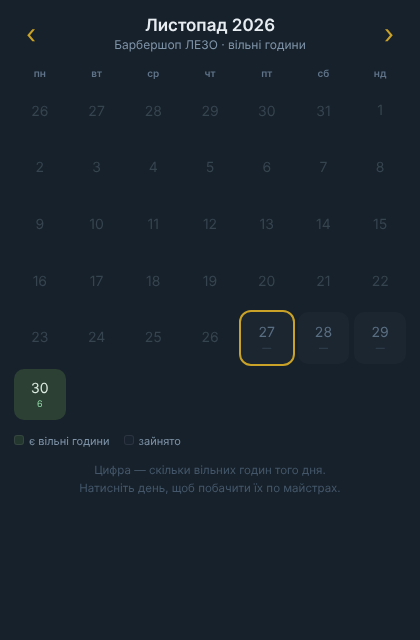
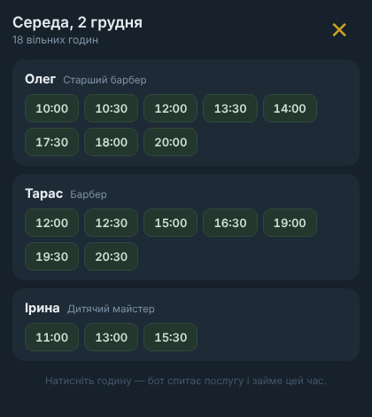

# Telegram-бот запису для сфери послуг

Система попереднього запису для барбершопів, салонів, тату-студій і автосервісів.
Один код обслуговує кілька закладів одночасно: у кожного свій бот, свої послуги,
майстри, ціни й база клієнтів.

Два працюючі боти, які можна відкрити й записатися просто зараз:

- [@lids_for_business_bot](https://t.me/lids_for_business_bot) — барбершоп
- [@lids_for_tatoo_bot](https://t.me/lids_for_tatoo_bot) — тату-студія

---

## Що вміє

**Запис без переписки.** Клієнт обирає послугу, майстра, день і годину. Зайнятий час
зникає з вибору, тож накладка неможлива. Послуга на півтори години забирає стільки
клітинок сітки, скільки реально триває.

**Свій графік у кожного майстра.** Робочі дні, години, особисті вихідні, власний
перелік послуг і власні ціни на ті самі послуги.

**Розклад у вигляді сторінки.** Міні-застосунок Telegram: місяць, окремий день по
колонках майстрів і список усіх найближчих записів. Власник бачить записи з
телефонами й оплатами, клієнт — лише вільні години.

| Вільні години, місяць | Вільні години, день | Список записів |
|---|---|---|
|  |  |  |

**Передоплата.** Фіксована сума або відсоток від вартості. Клієнт надсилає квитанцію,
адміністратор підтверджує кнопкою — і кнопки зникають одразу в усіх, хто її бачив.

**Повторні клієнти.** Бот упізнає людину, вітає особисто й рахує знижку. На кроці
імені можна записати себе або іншу людину; своїм дані підставляються автоматично.

**Робочий чат команди.** Нові записи, скасування й оплати приходять у групу. Відповідь
на повідомлення з питанням клієнта йде прямо йому, а саме питання позначається як
закрите в усіх копіях.

**Google Таблиця.** Кожен запис і кожна зміна лягають рядком у таблицю власника через
Apps Script, з чергою й повторними спробами, якщо таблиця недоступна.

**Нагадування, відгуки, повернення.** Нагадування за добу й за годину, запит оцінки
після візиту, лист тим, хто давно не приходив.

---

## Як це влаштовано

```
Telegram  ──►  bot.py       довгий опит, сценарії, нагадування
                  │
                  ├──►  slots.py    спільні правила розкладу
                  │
                  ├──►  SQLite      записи, стан діалогу, черга подій
                  │
                  └──►  web.py      HTTPS-сервер сторінки розкладу
                           │
                           └──►  miniapp.html   календар у Telegram
```

**Без зовнішніх бібліотек.** Тільки стандартна бібліотека Python 3.9+: `http.client`,
`ssl`, `sqlite3`, `hmac`, `threading`. Ставиться на будь-який сервер без `pip`.

**Один процес на всіх клієнтів.** `run_all.py` піднімає кожного бота в окремому потоці
зі своїм конфігом і своєю базою.

**Пул зʼєднань.** Telegram API викликається через постійні TLS-зʼєднання з повторним
використанням сесії і пріоритетом IPv4 — без цього кожен крок діалогу коштував
зайву секунду, а холодний старт тягнувся 25 секунд.

**Перевірка підпису.** Сторінка розкладу приймає `initData` від Telegram і звіряє
HMAC-SHA256 з токеном бота. Доступ до чужих записів закритий на сервері, а не в
інтерфейсі: клієнт фізично не може отримати телефони інших людей.

---

## Тести

```
python3 tests/test_flow.py        # повний сценарій запису
python3 tests/test_slotlink.py    # дотик по вільній годині в календарі
python3 tests/test_repeat.py      # повторні клієнти та знижка
```

569 перевірок у 25 файлах. Тести писалися не для галочки, а після кожної реальної
поломки: витік файлових дескрипторів, зависання на мертвих зʼєднаннях, мовчазна
втрата рядків у черзі до Google Таблиці, запис на годину, яку щойно зайняв інший.

---

## Запуск

```bash
cp config.example.json config.json   # вписати токен від BotFather
python3 bot.py
```

Докладно — у [DOCS.md](DOCS.md): налаштування під нішу, майстри, передоплата,
Google Таблиця, сторінка розкладу з сертифікатом, перенесення на сервер.

---

## English

Appointment booking system for service businesses, built as Telegram bots with a
Mini App schedule. Multi-tenant: one codebase, separate bot, config and database per
venue. Pure Python 3.9+ standard library, no dependencies — connection pooling and
TLS session reuse implemented by hand. Clients see free slots only; staff see the full
schedule, validated server-side through Telegram `initData` HMAC. 569 tests.
