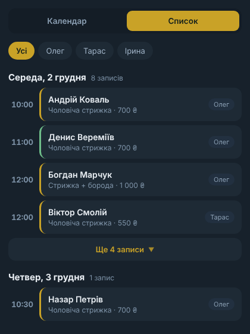

# Telegram-бот запису для сфери послуг
### Appointment booking bots for service businesses

Система попереднього запису для барбершопів, салонів, тату-студій і автосервісів.
Один код обслуговує кілька закладів одночасно: у кожного свій бот, свої послуги,
майстри, ціни й база клієнтів.

*A booking system for barbershops, salons, tattoo studios and auto services. One
codebase serves several venues at once: each gets its own bot, services, staff,
prices and client database.*

Два працюючі боти, які можна відкрити й записатися просто зараз:
*Two live bots you can open and book in right now:*

- [@lids_for_business_bot](https://t.me/lids_for_business_bot) — барбершоп · *barbershop*
- [@lids_for_tatoo_bot](https://t.me/lids_for_tatoo_bot) — тату-студія · *tattoo studio*

---

## Що вміє · What it does

**Запис без переписки.** Клієнт обирає послугу, майстра, день і годину. Зайнятий час
зникає з вибору, тож накладка неможлива. Послуга на півтори години забирає стільки
клітинок сітки, скільки реально триває.

*Booking without messaging. The client picks a service, a master, a day and an hour.
Taken slots disappear from the list, so double-booking cannot happen. A 90-minute
service occupies as many grid cells as it actually lasts.*

**Свій графік у кожного майстра.** Робочі дні, години, особисті вихідні, власний
перелік послуг і власні ціни на ті самі послуги.

*Per-master schedules. Working days, hours, personal days off, an individual service
list and individual prices for the same services.*

**Розклад у вигляді сторінки.** Міні-застосунок Telegram: місяць, окремий день по
колонках майстрів і список усіх найближчих записів. Власник бачить записи з
телефонами й оплатами, клієнт — лише вільні години.

*The schedule as a page. A Telegram Mini App: a month view, a single day split into
per-master columns, and a list of all upcoming bookings. The owner sees bookings with
phone numbers and payments; the client sees free hours only.*

| Вільні години, місяць · Free hours, month | Вільні години, день · Free hours, day | Список записів · Bookings list |
|---|---|---|
|  |  |  |

**Передоплата.** Фіксована сума або відсоток від вартості. Клієнт надсилає квитанцію,
адміністратор підтверджує кнопкою — і кнопки зникають одразу в усіх, хто її бачив.

*Deposits. A fixed amount or a percentage of the price. The client sends a receipt and
an administrator confirms it with a button — the buttons then disappear everywhere at
once, for everyone who saw them.*

**Повторні клієнти.** Бот упізнає людину, вітає особисто й рахує знижку. На кроці
імені можна записати себе або іншу людину; своїм дані підставляються автоматично.

*Returning clients. The bot recognises the person, greets them by name and applies a
discount. At the name step they can book for themselves or for someone else; for
themselves, the stored details are filled in automatically.*

**Робочий чат команди.** Нові записи, скасування й оплати приходять у групу. Відповідь
на повідомлення з питанням клієнта йде прямо йому, а саме питання позначається як
закрите в усіх копіях.

*Team chat. New bookings, cancellations and payments arrive in a group. Replying to a
client's question sends the answer straight to them, and the question itself is marked
as handled in every copy.*

**Google Таблиця.** Кожен запис і кожна зміна лягають рядком у таблицю власника через
Apps Script, з чергою й повторними спробами, якщо таблиця недоступна.

*Google Sheets. Every booking and every change lands as a row in the owner's
spreadsheet through Apps Script, with an outbox queue and retries when the sheet is
unreachable.*

**Нагадування, відгуки, повернення.** Нагадування за добу й за годину, запит оцінки
після візиту, лист тим, хто давно не приходив.

*Reminders, reviews, win-back. Reminders a day and an hour before, a rating request
after the visit, and a message to clients who stopped coming.*

---

## Як це влаштовано · How it works

```
Telegram  ──►  bot.py       довгий опит, сценарії, нагадування
                  │         long polling, dialogue flow, reminders
                  │
                  ├──►  slots.py    спільні правила розкладу
                  │                 shared scheduling rules
                  │
                  ├──►  SQLite      записи, стан діалогу, черга подій
                  │                 bookings, dialogue state, event queue
                  │
                  └──►  web.py      HTTPS-сервер сторінки розкладу
                           │        HTTPS server for the schedule page
                           │
                           └──►  miniapp.html   календар у Telegram
                                                the calendar inside Telegram
```

**Без зовнішніх бібліотек.** Тільки стандартна бібліотека Python 3.9+: `http.client`,
`ssl`, `sqlite3`, `hmac`, `threading`. Ставиться на будь-який сервер без `pip`.

*No external dependencies. Python 3.9+ standard library only: `http.client`, `ssl`,
`sqlite3`, `hmac`, `threading`. Installs on any server without `pip`.*

**Один процес на всіх клієнтів.** `run_all.py` піднімає кожного бота в окремому потоці
зі своїм конфігом і своєю базою.

*One process for all tenants. `run_all.py` starts each bot in its own thread with its
own config and its own database.*

**Пул зʼєднань.** Telegram API викликається через постійні TLS-зʼєднання з повторним
використанням сесії і пріоритетом IPv4 — без цього кожен крок діалогу коштував
зайву секунду, а холодний старт тягнувся 25 секунд.

*Connection pooling. The Telegram API is called over persistent TLS connections with
session reuse and IPv4 preference. Without it every dialogue step cost an extra second
and a cold start took 25.*

**Перевірка підпису.** Сторінка розкладу приймає `initData` від Telegram і звіряє
HMAC-SHA256 з токеном бота. Доступ до чужих записів закритий на сервері, а не в
інтерфейсі: клієнт фізично не може отримати телефони інших людей.

*Signature verification. The schedule page accepts Telegram `initData` and verifies the
HMAC-SHA256 against the bot token. Access to other people's bookings is closed on the
server, not in the interface: a client physically cannot retrieve anyone's phone number.*

---

## Тести · Tests

```
python3 tests/test_flow.py        # повний сценарій запису · full booking flow
python3 tests/test_slotlink.py    # дотик по вільній годині · tap-to-book from the calendar
python3 tests/test_repeat.py      # повторні клієнти та знижка · returning clients and discount
```

569 перевірок у 25 файлах. Тести писалися не для галочки, а після кожної реальної
поломки: витік файлових дескрипторів, зависання на мертвих зʼєднаннях, мовчазна
втрата рядків у черзі до Google Таблиці, запис на годину, яку щойно зайняв інший.

*569 assertions across 25 files. These were not written for show but after each real
failure: a file-descriptor leak, hangs on dead pooled connections, rows silently lost
from the Google Sheets queue, and a booking taken for an hour someone had just filled.*

---

## Запуск · Running it

```bash
cp config.example.json config.json   # вписати токен від BotFather · add your BotFather token
python3 bot.py
```

Докладно — у [DOCS.md](DOCS.md): налаштування під нішу, майстри, передоплата,
Google Таблиця, сторінка розкладу з сертифікатом, перенесення на сервер.

*Full guide in [DOCS.md](DOCS.md): niche configuration, masters, deposits, Google
Sheets, the schedule page with a certificate, and moving everything to a server.*
